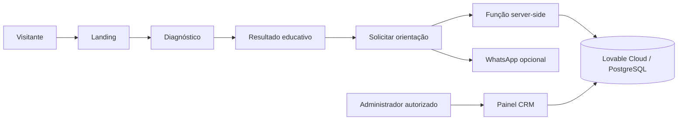

# 🛡️ CiberRadar PME — Diagnóstico de Segurança Digital

**MVP de validação de negócio | Desafio prático DIO | Lovable + GitHub**

[](https://pixel-perfect-replay-4997.lovable.app/)
[](https://lovable.dev)

> **Descubra o nível de proteção digital da sua empresa.**  
> O CiberRadar PME oferece um autodiagnóstico educativo gratuito sobre práticas básicas de segurança, gera recomendações e permite solicitar orientação pelo WhatsApp.

**Aplicação publicada:** https://pixel-perfect-replay-4997.lovable.app/  
**Repositório oficial (código-fonte):** https://github.com/LuizPedrao/pixel-perfect-replay-4997  
**Autor:** [LuizPedrao](https://github.com/LuizPedrao)  
**Documentação atualizada em:** 22 de outubro de 2026

---

## 🎯 1. A dor e a oportunidade

Pequenos negócios frequentemente não sabem como avaliar práticas básicas de proteção digital nem que ações priorizar. Falta visibilidade sobre autenticação multifator, backup, controle de acessos, proteção de endpoints, atualizações e conscientização.

A proposta do CiberRadar PME é reduzir esse primeiro obstáculo: **transformar dúvidas sobre segurança em um diagnóstico inicial acessível e uma oportunidade de orientação humana**.

O resultado não é auditoria, pentest, certificação ou comprovação de conformidade. Nenhum sistema do visitante é inspecionado.

## 🧪 2. Tese e escopo do MVP

**Tese:** parte dos gestores de pequenos negócios aceitará responder dez perguntas sobre sua segurança, considerará as recomendações úteis e poderá solicitar orientação pelo WhatsApp.

**O que o MVP testa:** entendimento da proposta, conclusão do diagnóstico, utilidade percebida, conversão em lead e interesse no contato.

**O que ficou manual de propósito:** qualificação, conversa comercial, proposta, pagamento, prestação do serviço e follow-up humano. **Não** foram integrados Stripe, Resend, n8n, chatbot ou scanner de vulnerabilidades. O painel ajuda a organizar essas atividades.

## 🌎 3. Mercado: TAM, SAM, SOM

Estudo exploratório baseado em uma fonte pública e recortes **hipotéticos**, não em clientes já conquistados:

| Indicador | Referência/cenário | Status |
|---|---:|---|
| **TAM** — universo de pequenos negócios | ~24 milhões de negócios ativos no Brasil | Referência de escala (Sebrae, 2026) |
| **SAM** — 1% do universo inicial | 240 mil negócios | Hipótese de segmentação |
| **SOM** — 0,01% do SAM em 12 meses | 24 clientes | Objetivo hipotético; não validado |

**Fonte:** [Sebrae — Pequenos negócios somam 24 milhões de empresas ativas](https://agenciasebrae.com.br/dados/pequenos-negocios-somam-24-milhoes-de-empresas-ativas/) (26/06/2026, atualizado em 06/07/2026).

Esses números modelam empresas, **não** receita comprovada nem disposição de compra. Justificativas e limitações em [Mercado e TAM/SAM/SOM](docs/01-mercado-tam-sam-som.md).

## 🧩 4. Business Model Canvas

| Bloco | Hipótese principal |
|---|---|
| Segmentos | Pequenas empresas e gestores sem equipe dedicada de segurança |
| Proposta de valor | Diagnóstico simples e recomendações educativas |
| Canais | Landing page, networking, indicações, WhatsApp |
| Relacionamento | Autoatendimento inicial + orientação humana |
| Receita | Futuras consultorias/serviços de diagnóstico aprofundado — não validados |
| Recursos | Plataforma, infraestrutura gerenciada e conhecimento técnico |
| Atividades | Captação, diagnóstico, atendimento e melhoria contínua |
| Parcerias | Lovable e eventuais prestadores/parceiros ainda a validar |
| Custos | Ferramenta, hospedagem, suporte, divulgação e tempo |

Canvas detalhado: [Business Model Canvas](docs/02-business-model-canvas.md).

## 🖥️ 5. Funcionalidades implementadas no código

### Jornada do visitante
- Landing page com apresentação e chamada para ação.
- Questionário progressivo com 10 perguntas (Sim / Não / Não sei).
- Índice educativo de 0 a 100: `Sim=10`, `Não sei=3`, `Não=0`.
- Faixas: **0–39** alta necessidade de atenção, **40–69** proteção em desenvolvimento, **70–100** boas práticas iniciais.
- Resultado imediato com pontos positivos e recomendações determinísticas.
- Solicitação opcional de orientação com consentimentos distintos para contato e marketing.
- Link de WhatsApp com mensagem personalizada quando configurado.

### Painel administrativo
- Login e verificação de papel de administrador.
- Visão geral com indicadores de registros.
- Gestão de leads, status e observações.
- Conversão de lead em cliente.
- Acompanhamento de diagnósticos, entregas e lembretes.
- Configurações de WhatsApp e e-mail de contato.

> A presença de código não substitui homologação: **testes ponta a ponta e segurança em produção ainda precisam ser comprovados**. Consulte [Plano de testes](docs/06-plano-de-testes.md).

## 🧱 6. Stack e arquitetura

Tecnologias identificadas no repositório:
- **React 19, TypeScript, Tailwind CSS 4** e componentes Radix/shadcn.
- **TanStack Router/Start e TanStack Query**.
- **Lovable Cloud**, com integração Supabase/PostgreSQL para autenticação e dados gerenciados.
- **Drizzle** para esquema/migrações presentes no projeto.
- **Zod e React Hook Form** para validação e formulário.
- **Vitest** para testes unitários.
- **GitHub** para versionamento com sincronização bidirecional via Lovable.



**Principais arquivos:**
- `src/lib/scoring.ts`: perguntas, pontuação e recomendações.
- `src/lib/leads.functions.ts`: cadastro validado no servidor.
- `src/routes/`: rotas públicas e administrativas.
- `src/components/site/`: componentes da jornada pública.
- `drizzle/migrations/0000_migration.sql`: tabelas e políticas de acesso.
- `src/lib/scoring.test.ts`: cenários de testes unitários.

## 🚀 7. Como executar localmente

Pré-requisitos: Git, Node.js compatível com as dependências e npm (ou ambiente Bun apropriado).

```bash
git clone https://github.com/LuizPedrao/pixel-perfect-replay-4997.git
cd pixel-perfect-replay-4997
npm install
npm run dev
```

Comandos disponíveis:
```bash
npm run lint
npm test
npm run build
```

**Observação:** a execução com backend exige variáveis de ambiente e credenciais de serviços gerenciados configuradas corretamente. Não versionar segredos privados ou chaves administrativas. Conecte/configure os recursos pertinentes pelo Lovable Cloud.

## 🔐 8. Segurança e LGPD

No código há autenticação administrativa, políticas de RLS, validações client/server, limite de envios, honeypot e avisos sobre o caráter educativo da avaliação.

**Pendências antes de uso comercial e abertura pública do GitHub:**
- Revisar o histórico e o arquivo `.env` (atualmente versionado, com URLs, IDs e chaves **publishable**; não confundir estas últimas com service-role secrets).
- Validar RLS com visitante, usuário comum e administrador.
- Executar o Security Review no Lovable e corrigir falhas.
- Preencher informações ainda pendentes do responsável nas páginas legais.
- Configurar o administrador inicial e contatos reais pelos meios adequados.
- Evitar expor dados pessoais de testes e prints.

Detalhes: [Segurança e publicação](docs/07-seguranca-e-publicacao.md).

## 📚 9. Documentação da entrega DIO

| Documento | Conteúdo |
|---|---|
| [01 — Mercado, TAM/SAM/SOM](docs/01-mercado-tam-sam-som.md) | Dimensionamento e limites das estimativas |
| [02 — Business Model Canvas](docs/02-business-model-canvas.md) | Modelo de negócio em 9 blocos |
| [03 — Hipóteses e validação](docs/03-hipoteses-validacao.md) | Experimentos e critérios de aprendizagem |
| [04 — Mega prompt](docs/04-mega-prompt.md) | Prompt-base e requisitos para o Lovable |
| [05 — Correções e decisões](docs/05-correcoes-e-decisoes.md) | Histórico real e modelo para registrar correções |
| [06 — Plano de testes](docs/06-plano-de-testes.md) | Cenários funcionais e técnicos |
| [07 — Segurança e publicação](docs/07-seguranca-e-publicacao.md) | Cuidados e checklist de abertura |
| [Evidências](evidencias/README.md) | Roteiro de prints reais a inserir |

**Importante:** não há testes de mercado concluídos nem correções pós-homologação comprovadas nos registros deste README. Esses pontos devem ser atualizados após a validação prática.

## 📷 10. Evidências da aplicação

Capturas de tela da aplicação ainda precisam ser adicionadas em `evidencias/`: landing page, diagnóstico, resultado, formulário, dashboard, leads, clientes, entregas, lembretes e revisão de segurança.

Capturas devem ser reais e anonimizar dados pessoais.

## 🧭 11. Evolução proposta

**Agora:** homologar fluxos, registrar prints, provisionar administrador, configurar contatos e revisar segurança/LGPD.

**Depois de validar interesse real:** refinar recomendações, automatizar alertas com e-mail, avaliar cobrança e integrar ferramentas de atendimento. Não antecipar funcionalidades complexas sem sinais concretos de demanda.

## 📦 12. Entrega da DIO

- **Link do aplicativo:** https://pixel-perfect-replay-4997.lovable.app/
- **Link a submeter na plataforma:** https://github.com/LuizPedrao/pixel-perfect-replay-4997
- **Status do repositório na revisão inicial:** privado; torná-lo público **somente depois** de revisar segurança, segredos e dados pessoais.
- **Status da integração:** código sincronizado entre Lovable e branch `main`.

---

**Desenvolvido como projeto de aprendizagem e validação de negócio com IA como parceira de ideação, Lovable para implementação do MVP e GitHub para portfólio.**
